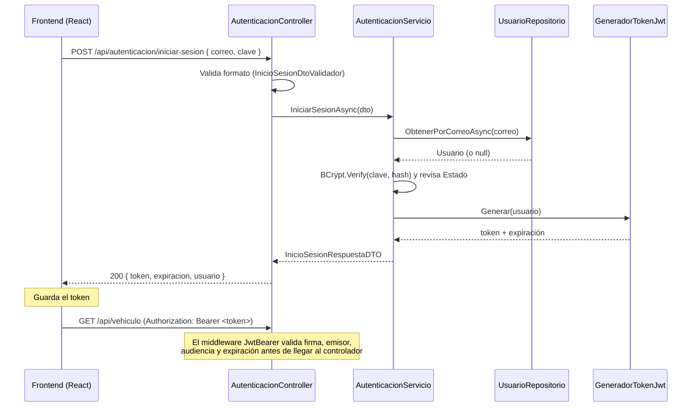

# Autenticación y autorización con JWT

Este documento explica cómo funciona la seguridad del backend de SonDrive: el inicio de sesión, el token JWT, los roles y cómo controlar qué puede hacer cada usuario en cada endpoint.

---

## 1. Conceptos básicos

- **Autenticación**: saber *quién* hace la petición. En SonDrive se logra con correo + clave, que a cambio entregan un **token JWT**.
- **Autorización**: decidir *qué puede hacer* esa persona. Se basa en el **rol** que viene dentro del token (`Administrador` o `Conductor`).

### ¿Qué es un JWT?

Un JWT (JSON Web Token) es un texto con tres partes separadas por puntos:

```
eyJhbGciOiJIUzI1NiJ9 . eyJzdWIiOiIxIiwicm9sIjoiQWRtaW5pc3RyYWRvciJ9 . kH3x...firma
     encabezado                     datos (claims)                       firma
```

- **Encabezado**: el algoritmo de firma (HS256).
- **Datos (claims)**: información del usuario (id, correo, rol...) y la fecha de expiración. **No están cifrados**, solo codificados en Base64: cualquiera puede leerlos (por ejemplo en [jwt.io](https://jwt.io)). Por eso nunca se guarda la clave ni datos sensibles en el token.
- **Firma**: se calcula con una clave secreta que solo conoce el servidor (`Jwt:Clave`). Si alguien modifica los datos (por ejemplo cambia su rol a `Administrador`), la firma deja de coincidir y el servidor rechaza el token.

El servidor **no guarda sesiones**: cada petición trae su token y el servidor solo verifica la firma y la fecha de expiración. Por eso la API es *stateless*.

---

## 2. Flujo completo



1. El usuario envía correo y clave.
2. El servicio busca el usuario por correo (normalizado a minúsculas), verifica la clave contra el hash BCrypt y comprueba que esté activo (`Estado = true`).
3. Si todo está bien, se genera un token firmado con validez de 8 horas (configurable).
4. El frontend envía ese token en **cada** petición, en el encabezado `Authorization: Bearer <token>`.
5. ASP.NET Core valida el token automáticamente. Si es inválido o venció → **401**. Si es válido pero el rol no tiene permiso → **403**. Ambas respuestas llevan cuerpo **ProblemDetails** (`application/problem+json`, con `status`), igual que el resto de errores de la API: `AddProblemDetails()` + `app.UseStatusCodePages()` en `Program.cs` le dan cuerpo a los errores que el pipeline de autorización devolvía vacíos.

---

## 3. Endpoints de autenticación

### `POST /api/autenticacion/iniciar-sesion` (público)

Petición:

```json
{
  "correo": "admin@sondrive.com",
  "clave": "Admin12345*"
}
```

Respuesta `200`:

```json
{
  "token": "eyJhbGciOi...",
  "expiracion": "2026-10-05T23:15:00Z",
  "usuario": {
    "id": 1,
    "nombre": "Administrador",
    "apellido": "SonDrive",
    "correo": "admin@sondrive.com",
    "celular": "3000000000",
    "estado": true,
    "rol": "Administrador",
    "foto": null
  }
}
```

Errores posibles:

| Código | Cuándo |
|---|---|
| 400 | Correo con formato inválido o clave vacía (FluentValidation) |
| 401 | Correo o clave incorrectos (mismo mensaje para ambos casos), o usuario desactivado |

> Se responde el **mismo mensaje** si el correo no existe o si la clave es incorrecta, y además se verifica contra un hash de relleno cuando el correo no existe, para que la respuesta tarde lo mismo. Así un atacante no puede averiguar qué correos están registrados.

### `GET /api/autenticacion/perfil` (requiere token)

Devuelve los datos (`UsuarioDto`) del usuario dueño del token. Útil para que el frontend recupere el usuario al recargar la página.

---

## 4. Contenido del token (claims)

| Claim | Contenido | Constante |
|---|---|---|
| `sub` | Id del usuario | `NombresClaims.IdUsuario` |
| `email` | Correo | `NombresClaims.Correo` |
| `nombre` | Nombre y apellido | `NombresClaims.Nombre` |
| `rol` | `Administrador` o `Conductor` | `NombresClaims.Rol` |
| `iss` | Emisor (`Jwt:Emisor`) | — |
| `aud` | Audiencia (`Jwt:Audiencia`) | — |
| `exp` | Fecha de expiración | — |

En `Program.cs` se configura `MapInboundClaims = false`, de modo que los claims se leen con estos mismos nombres cortos, y `RoleClaimType = "rol"`, para que `[Authorize(Roles = ...)]` y `User.IsInRole(...)` usen el claim `rol`.

---

## 5. Qué hay en cada capa

Se respeta la arquitectura en capas: `Biblioteca` contiene las reglas de negocio y **no depende de librerías de JWT**; los detalles técnicos del token viven en `API`.

### Biblioteca

| Archivo | Responsabilidad |
|---|---|
| `Seguridad/Roles.cs` | Constantes de los roles (`Roles.Administrador`, `Roles.Conductor`, `Roles.Todos`). |
| `DTO/InicioSesion/InicioSesionDTO.cs` | Datos de entrada: correo y clave. |
| `DTO/InicioSesion/InicioSesionRespuestaDTO.cs` | Token, expiración y datos del usuario. |
| `Servicios/Interfaces/IAutenticacionServicio.cs` | Contrato del inicio de sesión. |
| `Servicios/Implementaciones/AutenticacionServicio.cs` | Reglas: buscar usuario, verificar clave con BCrypt, revisar `Estado`, pedir el token. |
| `Servicios/Interfaces/IGeneradorToken.cs` | Contrato para generar tokens (la implementación está en API). |
| `Excepciones/Excepciones.cs` | `CredencialesInvalidasException` → el middleware responde 401. |

### API

| Archivo | Responsabilidad |
|---|---|
| `Controllers/AutenticacionController.cs` | Endpoints `iniciar-sesion` y `perfil`. |
| `Validaciones/InicioSesion/InicioSesionDtoValidador.cs` | Formato del correo y clave obligatoria. |
| `Seguridad/ConfiguracionJwt.cs` | Clase que representa la sección `Jwt` de la configuración. |
| `Seguridad/GeneradorTokenJwt.cs` | Implementa `IGeneradorToken`: arma y firma el JWT. |
| `Seguridad/NombresClaims.cs` | Nombres de los claims del token. |
| `Seguridad/ExtensionesUsuarioActual.cs` | `User.ObtenerIdUsuario()`, `User.EsAdministrador()`, `User.PuedeAccederAUsuario(id)`. |
| `Seguridad/InicializadorAdministrador.cs` | Crea el primer administrador al arrancar si no existe ninguno. |
| `Seguridad/TransformadorSeguridadOpenApi.cs` | Agrega el botón **Authorize** en Swagger UI. |
| `Middleware/ManejoExcepcionesMiddleware.cs` | Convierte `CredencialesInvalidasException` en 401. |
| `Program.cs` | Registra autenticación JWT, la política por defecto y los servicios. |

---

## 6. Configuración

### Sección `Jwt`

`appsettings.json` (valores no secretos, comunes a todos los ambientes):

```json
"Jwt": {
  "Emisor": "SonDriveAPI",
  "Audiencia": "SonDriveFrontend",
  "MinutosExpiracion": 480
}
```

`appsettings.Development.json` (solo desarrollo):

```json
"Jwt": {
  "Clave": "clave-solo-para-desarrollo-sondrive-cambiar-en-produccion"
}
```

- `Clave` debe tener **mínimo 32 caracteres**. Si falta, la API **no arranca** y muestra un error explicando qué configurar.
- Quien conozca la clave puede fabricar tokens de cualquier usuario y rol. En producción **nunca** debe estar en el repositorio; se configura con una variable de entorno:

  ```bash
  # Variable de entorno (el doble guion bajo equivale a ":")
  Jwt__Clave=una-clave-larga-y-aleatoria-de-produccion
  ```

  o con user secrets en un equipo local:

  ```bash
  dotnet user-secrets set "Jwt:Clave" "una-clave-larga-y-aleatoria" --project API
  ```

- Cambiar la clave invalida todos los tokens emitidos (todos los usuarios deben volver a iniciar sesión).

### Sección `AdministradorInicial`

Crear usuarios requiere ser administrador, así que se necesita un primer administrador. Al arrancar, `CrearAdministradorInicialAsync` revisa si existe algún usuario con rol `Administrador`; si **no** existe, lo crea con estos datos:

```json
"AdministradorInicial": {
  "Nombre": "Administrador",
  "Apellido": "SonDrive",
  "Correo": "admin@sondrive.com",
  "Clave": "Admin12345*",
  "Celular": "3000000000"
}
```

- Solo actúa si no hay ningún administrador: no modifica ni sobrescribe usuarios existentes.
- Si la base de datos no está disponible al arrancar, registra el error en el log y la API sigue funcionando.
- En producción, configure estos datos con variables de entorno (`AdministradorInicial__Correo`, `AdministradorInicial__Clave`, ...) y cambie la clave después del primer ingreso.

### Sección `Cors`

La política `PermitirFrontend` solo admite los orígenes de `Cors:Origenes` (no se usa `AllowAnyOrigin()`, principio IV de la constitución):

```json
"Cors": {
  "Origenes": [ "http://localhost:5173" ]
}
```

- `appsettings.Development.json` permite el servidor de desarrollo de Vite (`http://localhost:5173`); `appsettings.json` deja la lista vacía.
- **Lista vacía = ningún origen permitido**: el navegador bloqueará las respuestas al frontend hasta configurarla.
- En otros ambientes se configura por variables de entorno (`Cors__Origenes__0=https://sondrive.ejemplo`, `Cors__Origenes__1=...`).
- No se habilita `AllowCredentials()`: el token viaja en el encabezado `Authorization`, no en cookies.

---

## 7. Cómo se protegen los endpoints

### Regla por defecto: todo requiere token

En `Program.cs` hay una **política de respaldo** (*fallback policy*):

```csharp
builder.Services.AddAuthorization(opciones =>
{
    opciones.FallbackPolicy = new AuthorizationPolicyBuilder()
        .RequireAuthenticatedUser()
        .Build();
});
```

Esto significa que **cualquier endpoint sin atributos de seguridad exige un token válido**. Es más seguro que lo contrario: si alguien crea un controlador nuevo y olvida protegerlo, queda protegido igual.

### Atributos disponibles

| Atributo | Efecto |
|---|---|
| *(ninguno)* | Requiere token válido, cualquier rol (por la política de respaldo). |
| `[AllowAnonymous]` | Público: no requiere token. Anula cualquier otro `[Authorize]`. |
| `[Authorize]` | Requiere token válido, cualquier rol (igual que no poner nada, pero explícito). |
| `[Authorize(Roles = Roles.Administrador)]` | Solo administradores. |
| `[Authorize(Roles = $"{Roles.Administrador},{Roles.Conductor}")]` | Administrador **o** Conductor (separados por coma = "cualquiera de"). |

Siempre use las constantes de `Biblioteca.Seguridad.Roles`, nunca el texto escrito a mano (`"Administrador"`), para evitar errores de escritura.

Necesitará estos `using` en el controlador:

```csharp
using Biblioteca.Seguridad;                 // Roles
using Microsoft.AspNetCore.Authorization;   // [Authorize], [AllowAnonymous]
using API.Seguridad;                        // User.ObtenerIdUsuario(), etc.
```

### Ejemplo 1: todo un controlador solo para administradores

```csharp
[ApiController]
[Route("api/[controller]")]
[Authorize(Roles = Roles.Administrador)]   // aplica a todas las acciones
public class RutaController : ControllerBase
{
    ...
}
```

### Ejemplo 2: restringir solo algunas acciones

```csharp
public class VehiculoController : ControllerBase
{
    [HttpGet]                                        // cualquier usuario autenticado
    public async Task<...> Listar(...) { ... }

    [Authorize(Roles = Roles.Administrador)]         // solo administradores
    [HttpDelete("{id:long}")]
    public async Task<IActionResult> Eliminar(...) { ... }
}
```

### Ejemplo 3: hacer público un endpoint

Por ejemplo, si el frontend necesita mostrar las ciudades o buscar viajes sin iniciar sesión:

```csharp
[AllowAnonymous]
[HttpGet]
public async Task<ActionResult<IEnumerable<CiudadResponseDTO>>> Listar(CancellationToken ct) { ... }
```

### ⚠️ Cuidado al combinar atributos

Cuando hay `[Authorize(Roles = ...)]` en el controlador **y** en la acción, se deben cumplir **ambos**. Por ejemplo:

```csharp
[Authorize(Roles = Roles.Administrador)]
public class UsuarioController : ControllerBase
{
    [Authorize(Roles = Roles.Conductor)]   // ❌ NO abre la acción a los conductores:
    public ... CambiarClave(...)           //    exige ser Administrador Y Conductor a la vez
}
```

Si la mayoría de acciones son solo para administradores pero algunas no, ponga el atributo **en cada acción** en lugar de en la clase. Así está hecho en `UsuarioController`.

La única excepción es `[AllowAnonymous]`, que sí anula todo lo demás.

### Ejemplo 4: permisos que dependen del dueño del recurso

Los roles responden a "¿qué tipo de usuario eres?", pero a veces la pregunta es "¿este recurso es tuyo?". Para eso se usa el id que viene en el token:

```csharp
// GET api/usuario/5 (administrador o el mismo usuario)
[HttpGet("{id:long}")]
public async Task<ActionResult<UsuarioDto>> ObtenerPorId(long id, CancellationToken ct)
{
    if (!User.PuedeAccederAUsuario(id))
        return Forbid();   // 403

    var usuario = await _servicio.ObtenerPorIdAsync(id, ct);
    return Ok(usuario);
}
```

Funciones disponibles (en `API/Seguridad/ExtensionesUsuarioActual.cs`):

| Función | Devuelve |
|---|---|
| `User.ObtenerIdUsuario()` | El id (`long`) del usuario autenticado. |
| `User.EsAdministrador()` | `true` si el rol es `Administrador`. |
| `User.PuedeAccederAUsuario(id)` | `true` si es administrador o si `id` es su propio id. |

Para recursos que no son el usuario (por ejemplo un vehículo), el controlador debe pasar `User.ObtenerIdUsuario()` al servicio y el servicio debe comprobar que el vehículo pertenece a ese usuario (por ejemplo lanzando una excepción si no es así). Así la regla de negocio queda en `Biblioteca` y no en el controlador.

---

## 8. Permisos actuales

| Endpoint | Administrador | Conductor | Sin token |
|---|---|---|---|
| `POST api/autenticacion/iniciar-sesion` | ✅ | ✅ | ✅ |
| `GET api/autenticacion/perfil` | ✅ | ✅ | ❌ 401 |
| `GET api/usuario` (listar) | ✅ | ❌ 403 | ❌ 401 |
| `GET api/usuario/{id}` | ✅ cualquiera | Solo el suyo | ❌ 401 |
| `POST api/usuario` (crear) | ✅ | ❌ 403 | ❌ 401 |
| `PUT api/usuario/{id}` | ✅ | ❌ 403 | ❌ 401 |
| `PUT api/usuario/{id}/clave` | ✅ cualquiera | Solo la suya | ❌ 401 |
| `PATCH api/usuario/{id}/estado` | ✅ | ❌ 403 | ❌ 401 |
| `DELETE api/usuario/{id}` | ✅ | ❌ 403 | ❌ 401 |
| Vehículos, viajes, ocupaciones, fallas, ciudades, rutas | ✅ | ✅ | ❌ 401 |

Los permisos del rol **Conductor** sobre los demás módulos están pendientes de definir; por ahora solo necesita estar autenticado. Para restringirlos, aplique los ejemplos de la sección 7.

---

## 9. Agregar un rol nuevo

1. Agregue la constante en `Biblioteca/Seguridad/Roles.cs` y súmela a `Todos`:

   ```csharp
   public const string Supervisor = "Supervisor";

   public static readonly IReadOnlyList<string> Todos = new[] { Administrador, Conductor, Supervisor };
   ```

2. Los validadores de crear/actualizar usuario ya usan `Roles.Todos`, así que aceptarán el nuevo rol automáticamente. Actualice el mensaje de error de esos validadores (`UsuarioCrearDtoValidador` y `UsuarioActualizarDtoValidator`), que hoy menciona solo dos roles.
3. La columna `Rol` admite hasta 30 caracteres; no requiere migración.
4. Use el nuevo rol en los atributos: `[Authorize(Roles = Roles.Supervisor)]`.

---

## 10. Uso desde el frontend

El frontend (`SonDriveFrontend`) ya implementa este flujo:

1. `features/autenticacion` llama a `iniciar-sesion` y guarda la respuesta completa (`token`, `expiracion`, `usuario`) en `localStorage` bajo la clave `sondrive.sesion`. Solo `features/autenticacion/sesion.ts` lee y escribe esa clave.
2. `lib/clienteHttp.ts` agrega `Authorization: Bearer <token>` a cada petición mientras la sesión esté vigente, y convierte las respuestas ProblemDetails en mensajes en español.
3. `usuario.rol` decide qué secciones y botones se muestran (`RutaProtegida`, `MostrarSiRol`). Esto es solo para la interfaz: **la seguridad real la aplica el backend**.
4. Cierre de la sesión:
   - Al llegar `expiracion`, se cierra sola; en una sección privada lleva a iniciar sesión y en una pública deja a la persona como visitante, con el aviso "Tu sesión venció. Inicia sesión de nuevo.".
   - Si una petición (que no sea el inicio de sesión) responde **401**, se borra la sesión y **siempre** se lleva a la pantalla de inicio de sesión, recordando la página en `?volver=`.
   - Cerrar sesión en una pestaña la cierra también en las demás.
5. Si responde **403**, el usuario está autenticado pero su rol no tiene permiso: se muestra "No tienes permiso para realizar esta acción.".

---

## 11. Cómo probarlo

### Swagger UI

1. `dotnet run --project API` y abrir `http://localhost:5064/swagger`.
2. Ejecutar `POST /api/autenticacion/iniciar-sesion` con el administrador inicial y copiar el `token`.
3. Pulsar **Authorize**, pegar el token (sin la palabra `Bearer`) y aceptar.
4. Desde ese momento las peticiones de Swagger llevan el token.

### Archivo `API/API.http`

Desde Visual Studio o VS Code (extensión REST Client): ejecutar la petición de inicio de sesión, pegar el token en la variable `@token` y ejecutar las demás.

---

## 12. Limitaciones conocidas y pendientes

- **Desactivar a un usuario no cierra su sesión de inmediato**: su token sigue siendo válido hasta que vence (máximo `MinutosExpiracion`, 8 horas por defecto). Bajar ese valor reduce el riesgo.
- **No hay *refresh token***: cuando el token vence, el usuario debe iniciar sesión de nuevo.
- **No hay límite de intentos de inicio de sesión**. Se puede agregar con el *rate limiter* de ASP.NET Core (`AddRateLimiter`) para frenar ataques de fuerza bruta.
- **Endpoints sin control de dueño**: `api/vehiculo/usuario/{idUsuario}` y `api/viaje/usuario/{idUsuario}` permiten a cualquier usuario autenticado consultar datos de otro. Debe resolverse al definir los permisos del Conductor (ver ejemplo 4).
- **CORS acepta cualquier origen** (`AllowAnyOrigin`). En producción conviene limitarlo al dominio del frontend.
